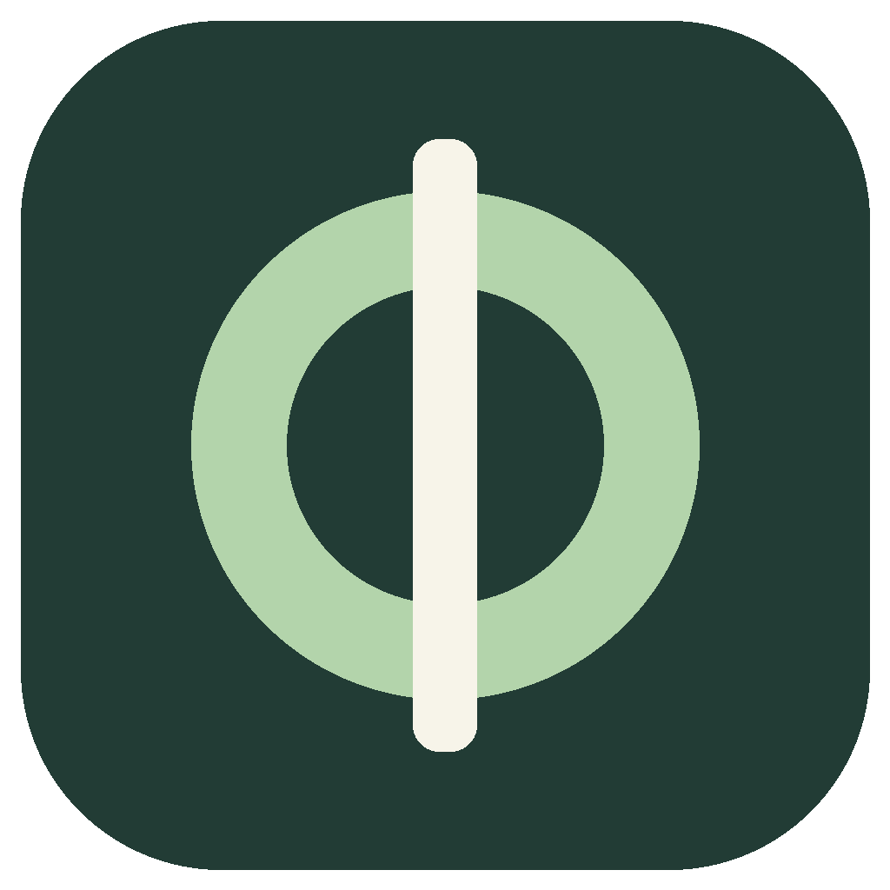
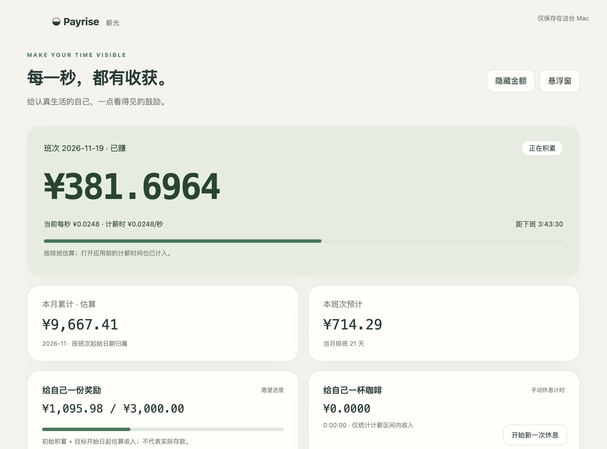

<div align="center">
  
  <h1>Payrise · 薪光</h1>
  <p>让每一秒的努力，看得见。</p>
  <p>一款本地优先的 macOS 实时收入伴侣。</p>
  <p><strong>简体中文</strong> · <a href="README.en.md">English</a></p>
  <p>macOS · Node.js + Electron · MIT</p>
</div>



薪光把你填写的薪资和作息，换算成不断更新的收入数字。放在菜单栏里，或留一个小窗口在桌面角落，看到一天的积累，也给自己一点下班前的鼓励。

## 功能

- **实时收入** — 每秒更新本班次估算收入、当前速率和本月累计，支持月薪、日薪、时薪。
- **菜单栏与悬浮窗** — 小号品牌图标，可拖动、置顶、调整透明度。
- **灵活作息** — 每周排班、午休扣除、手动调休和跨午夜班次。
- **加班记录** — 手动计时、历史补录、编辑和删除；支持无偿、自定义时薪及倍率计薪，保留每笔费率。
- **愿望与休息** — 看见离小目标还有多远，也能查看一次休息覆盖的计薪收入。
- **三套主题** — 窗光、纸页、夜灯，一键切换主窗口和悬浮窗。
- **本地隐私** — 无需账号，不上传工资；一键隐藏主窗口、小窗和菜单栏金额。
- **AI 主题定制** — 仓库附带主题 Skill，可让其他 AI 根据图片或设计稿接入新主题。


## 快速开始

需要 macOS、Node.js 22+ 和 npm。

```sh
git clone https://github.com/esaowandyacob/payrise.git
cd payrise
npm ci
npm start
```

首次启动后，在「薪资、作息与外观设置」中填写信息并保存。顶部切换主题；点击「悬浮窗」显示桌面小窗。关闭窗口后应用仍驻留菜单栏，按 `⌘Q` 完全退出。

目前提供源码运行方式，已在 Apple Silicon Mac 验证。自行打包的应用尚未经过 Apple 签名与公证，Intel Mac 尚未实机验证。开发与打包命令见 [贡献指南](CONTRIBUTING.md)。

## 主题

| 主题 | 风格 |
| --- | --- |
| 窗光 · Lumen | 明亮、克制，左对齐数字与简洁摘要 |
| 纸页 · Folio | 暖色账页、衬线标题、细线分隔 |
| 夜灯 · Wick | 深色背景、居中数字、柔和暖色 |

想用自己的素材做主题？把仓库和图片交给 AI，然后告诉它：

> 阅读 `.agents/skills/payrise-theme/SKILL.md`，根据我上传的素材新增主题，保留现有主题，并验证主窗口、悬浮窗、加班和隐私状态。

[主题 Skill](.agents/skills/payrise-theme/SKILL.md) · [主题开发约定](docs/THEMES.md)

## 收入如何计算

普通收入按设置的排班和系统时间估算，打开应用前的计薪时间也会计入。无薪休息期间暂停，正常班次结束后封顶；加班需手动开始或补录，单独计入。

- 月薪可按当月排班工作日或固定天数折算；跨夜班次按开始日期归属。
- 有偿加班并入累计，无偿加班只增加时长，并影响折算时薪。
- 普通收入会随薪资和排班修改而重算；加班记录保留原费率。
- 这是个人时间价值估算，不是工资条、银行余额或考勤系统；不计算税费与奖金。

详细口径、跨日规则与加班使用方法见 [使用指南](docs/USER_GUIDE.md)。

## 数据与隐私

应用无需联网工作，不含账号系统或分析 SDK。配置通常保存在本机 `~/Library/Application Support/Payrise/settings.json`，以明文存储；隐私按钮用于隐藏显示，不等同于磁盘加密。备份或删除数据前请先退出应用。

## 参与贡献

欢迎提交问题、体验反馈和 Pull Request。报告问题时请提供 macOS 版本、复现步骤和脱敏截图，不要上传自己的薪资配置。

[贡献指南](CONTRIBUTING.md) · [架构说明](docs/ARCHITECTURE.md) · [灵感来源](docs/REFERENCES.md)

## 许可证

[MIT](LICENSE)。依赖组件保留各自许可证。
